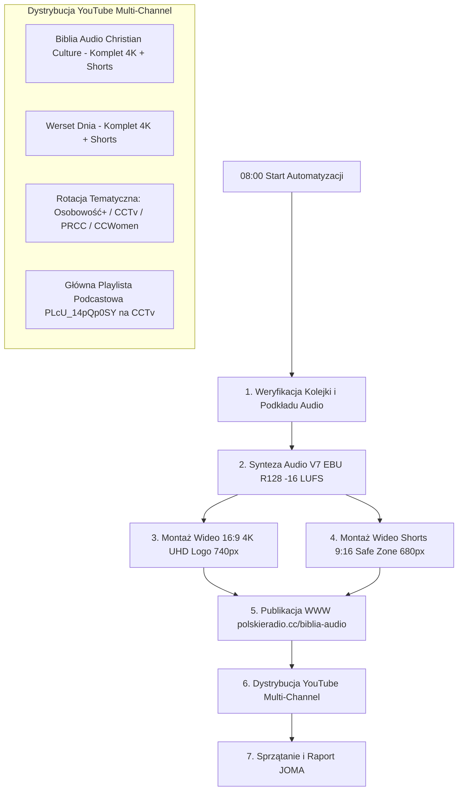

# 📜 Procedura Operacyjna Codziennej Automatyzacji: Biblia Audio & Multi-Channel Broadcast

> **Identyfikator:** `CC-AUTOMATION-BIBLIA-AUDIO-DAILY-0800`  
> **Harmonogram:** Codziennie o **08:00 (Europe/Warsaw)**  
> **Konfiguracja Sidecara:** `~/.gemini/config/sidecars/cc-biblia-audio-daily-production/sidecar.json`  
> **Zarządzanie:** Dashboard Automatyzacji Antigravity (`sidecar://dashboard`)  
> **Standard:** ZERO COST (0 PLN, Playwright Persistent Context, brak limitów API)

---

## 1. Zakres Działań i Chronologia Każdego Dnia



---

## 2. Matryca Kanałów YouTube i Ról Emisyjnych

| Kanał YouTube | Channel ID | Rola i Zakres Emisji | Status Uprawnień |
|---|---|---|---|
| **Biblia Audio Christian Culture** | `UCCqHRCEuSDhlRcvcQ6qM1Kw` | **Główny dom katalogu:** 100% pełnych filmów 16:9 4K UHD i Shorts 9:16 od Rdz 1 do końca Biblii | ✅ Aktywny (Menedżer) |
| **Werset Dnia - Chrześcijański Serwis Biblijny** | `UCyOvW5DuDLVq5XWFyijgtbw` | **Drugi dom katalogu:** 100% pełnych filmów 16:9 4K UHD i Shorts 9:16 od Rdz 1 do końca Biblii | ✅ Aktywny (Menedżer) |
| **Christian Culture TV** | `UCHmPxDM2zzlUAf5ZvlotPLw` | **Główna Playlista Podcastowa** (`PLcU_14pQp0SY`) + rotacja wybranch rozdziałów | ✅ Aktywny (Właściciel) |
| **Osobowość +** | `@osobowośćPLUS` | **Rotacja tematyczna:** rozdziały o tożsamości, człowieku i relacjach | ✅ Aktywny (Właściciel) |
| **Polskie Radio CHRISTIAN CULTURE** | `@RadioChristianCulture` | **Rotacja tematyczna:** rozdziały poetyckie, psalmy, wielkie narracje | ✅ Aktywny (Menedżer) |
| **CC Women** | `@CCWomen7` | **Rotacja tematyczna:** rozdziały poświęcone kobietom wiary i rodzinie | ✅ Aktywny (Właściciel) |

---

## 3. Komplet Narzędzi Skryptowych

1. **Publikacja YouTube (Playwright Persistent Context):**
   ```bash
   node scripts/publish_perfect.mjs <plik.mp4> <meta.json> <channelId> "<Nazwa Kanału>"
   ```
2. **Przełącznik tożsamości kanałów:**
   ```bash
   node scripts/youtube_channel_manager.mjs "<Nazwa Kanału>"
   ```
3. **Aktywacja zaproszeń do nowych kanałów:**
   ```bash
   node scripts/accept_werset_dnia.mjs
   ```
4. **Montaż automatyczny wideo:**
   ```bash
   uv run python "C:\Users\czark\Desktop\Biblia Audio CC — Gotowe do Emisji\render_video_episode.py" ...
   uv run python "C:\Users\czark\Desktop\Biblia Audio CC — Gotowe do Emisji\render_shorts_episode.py" ...
   ```
5. **Publikacja WWW i Cloudflare:**
   ```bash
   node "C:\Users\czark\Desktop\Biblia Audio Christian Culture\skrypty\publish_to_web_biblia_audio.mjs" ...
   ```

---

## 4. Rejestr Historii Publikacji
Każda publikacja na YouTube jest trwale zapisywana w pliku:
`C:\Users\czark\Christian_Culture_Projekty\polskieradio.cc\data\youtube_published_history.json`
Zapis obejmuje: tytuł, nazwę pliku, kanał, stały link YouTube (`https://youtu.be/...`), widoczność oraz znacznik czasu ISO 8601.
