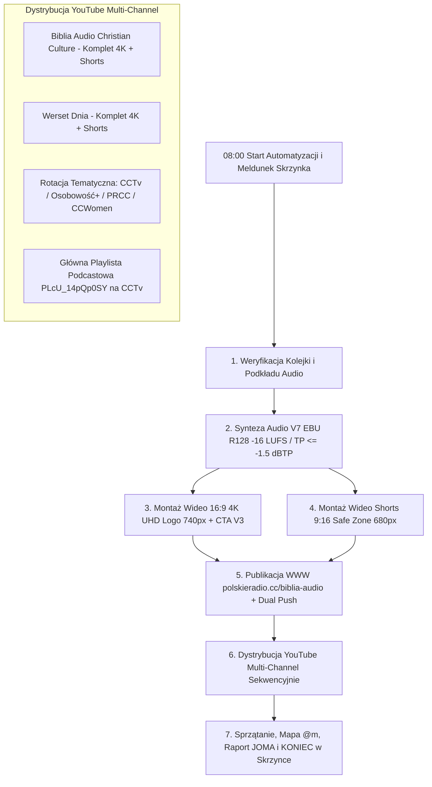

# 📜 Procedura Operacyjna Codziennej Automatyzacji: Biblia Audio V7 & Multi-Channel Broadcast (@777 / @JOMA / @ICC)

> **Identyfikator:** `CC-AUTOMATION-BIBLIA-AUDIO-DAILY-0800`  
> **Kanoniczny Dokument JOMA:** [`BIBLIA_AUDIO_V7_AUTOMATION_SOP_777.md`](file:///C:/Users/czark/Desktop/Misja%20CC/JOMA_SHARED_MEMORY/BIBLIA_AUDIO_V7_AUTOMATION_SOP_777.md)  
> **Harmonogram:** Codziennie o **08:00 (Europe/Warsaw)**  
> **Konfiguracja Sidecara:** `~/.gemini/config/sidecars/cc-biblia-audio-daily-production/sidecar.json`  
> **Standard:** ZERO-QA dla Dowódcy (JOMA-D005) + ZERO COST (0 PLN, Playwright Persistent Context) + 100% Verbatim UBG-2025

> ⚠️ **Korekta @007 (02.11.2026):** krok YouTube obowiązuje według JOMA_SHARED_MEMORY/BIBLIA_AUDIO_YOUTUBE_WYTYCZNE_A007.md: kanał wskazuje NAZWA (scripts/yt_studio_session.mjs), publikacja planowana (premiera +2 dni 18:00, jeden odcinek dziennie na kanał), sukces tylko po potwierdzeniu w Studio, ochrona przed dublami, kontrola 
ode scripts/yt_reconcile_history.mjs, naprawa 
ode scripts/yt_repair_biblia_audio.mjs. Duble usuwa wyłącznie człowiek.
---

## 🚨 0. Protokół Przejęcia Warty (Gdy Agentowi Wyczerpią Się Tokeny)

Gdy poprzedniemu agentowi wyczerpią się tokeny, każdy dyżurny agent Federacji `@777` (`Antigravity`, `Claude Code`, `Codex`, `Copilot`, `Joshua`) przejmuje realizację od dokładnego etapu zatrzymania:
1. **Brak `.mp3` / `.wav` dla kolejnego rozdziału w `01_Ksiega_Rodzaju/`** ➔ Start od **Etapu 1 i 2 (Kolejka + Synteza V7)**.
2. **Są pliki `.mp3` i `.wav`, brak `_4K.mp4` lub `_Shorts_9x16.mp4`** ➔ Start od **Etapu 3 i 4 (Montaż Wideo 4K i Shorts)**.
3. **Rozdział ma `status: "in_production"` w `biblia-audio/data/catalog.json`** ➔ Start od **Etapu 5 (Publikacja WWW)**.
4. **Brak wpisów dzisiejszego rozdziału w `data/youtube_published_history.json`** ➔ Start od **Etapu 6 (Dystrybucja Multi-Channel YouTube)**.

---

## 1. Zakres Działań i Chronologia Każdego Dnia



---

## 2. Matryca Kanałów YouTube i Ról Emisyjnych

| Kanał YouTube | Channel ID | Rola i Zakres Emisji | Status Uprawnień |
|---|---|---|---|
| **Biblia Audio Christian Culture** | `UCCqHRCEuSDhlRcvcQ6qM1Kw` | **Główny dom katalogu:** 100% pełnych filmów 16:9 4K UHD i Shorts 9:16 od Rdz 1 do końca Biblii | ✅ Aktywny (Menedżer) |
| **Werset Dnia - Chrześcijański Serwis Biblijny** | `UCyOvW5DuDLVq5XWFyijgtbw` | **Drugi dom katalogu:** 100% pełnych filmów 16:9 4K UHD i Shorts 9:16 od Rdz 1 do końca Biblii | ✅ Aktywny (Menedżer) |
| **Christian Culture TV** | `UCG5Y4dwJi5436Gu6QH3nNUQ` (uwaga: `UCHmPxDM2zzlUAf5ZvlotPLw` to Osobowość +) | **Główna Playlista Podcastowa** (`PLcU_14pQp0SY`) + rotacja wybranych rozdziałów | ✅ Aktywny (Właściciel) |
| **Osobowość +** | `@osobowośćPLUS` | **Rotacja tematyczna:** rozdziały o tożsamości, człowieku i relacjach | ✅ Aktywny (Właściciel) |
| **Polskie Radio CHRISTIAN CULTURE** | `@RadioChristianCulture` | **Rotacja tematyczna:** rozdziały poetyckie, psalmy, wielkie narracje | ✅ Aktywny (Menedżer) |
| **CC Women** | `@CCWomen7` | **Rotacja tematyczna:** rozdziały poświęcone kobietom wiary i rodzinie | ✅ Aktywny (Właściciel) |

---

## 3. Żelazne Parametry Techniczne i Komendy Wykonawcze

### Etap 1: Kolejka i Podkład Muzyczny
```powershell
node "C:\Users\czark\Desktop\Biblia Audio Christian Culture\skrypty\cc_daily_bible_producer.mjs"
```
- Rotacja podkładów instrumentalnych (100% bez wokalu): `GEN_podklad_A.mp3` (rozdziały nieparzyste) oraz `GEN_podklad_B.mp3` (rozdziały parzyste).
- Jeśli brakuje podkładu lub ukończono księgę ➔ **STOP**, alert do Dowódcy i wpis w `JOMA_HANDOFFS.md`.

### Etap 2: Synteza i Mastering V7 (`produce_gen0XX.mjs`)
- **Wzorzec referencyjny:** `C:\Users\czark\Desktop\Biblia Audio Christian Culture\skrypty\produce_gen011.mjs`
- **Tekst:** `C:\Users\czark\Desktop\Biblia Audio Christian Culture\teksty_ubg\ubg-2025\GEN-0XX.json` (100% Verbatim UBG-2025).
- **Głosy:** `Despina` (narracja) + `Enceladus` (wypowiedzi Boga/PANA i uroczyste zwieńczenia, weryfikacja YIN: $f_0 < 160\text{ Hz}$).
- **Tor V7:** EQ (`160Hz +2.2dB`, `900Hz -2.5dB`, `2600Hz -3.0dB`, `11.5kHz +1.5dB`) + pogłos 3D (`60|140|480ms`, `lowpass=3800Hz`), podkład `0.08` z kieszenią `-4dB @ 1800Hz`, intro `4.0s`, outro `3.5s` solo + `7.8s` fade-out + `2.0s` ciszy.
- **Mastering EBU R128:** Głośność zintegrowana **-16.0 LUFS (±0.5)**, limiter **`alimiter=limit=0.79:level=false`** (gwarantuje True Peak **<= -1.5 dBTP**).

### Etap 3 i 4: Montaż Wideo 4K (16:9) oraz Shorts (9:16)
> ⚠️ **UWAGA:** W PowerShell wywołuj zawsze środowisko Python z `.venv\Scripts\python.exe`, nigdy `python` z PATH!
1. Upewnij się, że rozdział jest dodany do `THEMES_DATABASE` w `C:\Users\czark\Desktop\Biblia Audio CC — Gotowe do Emisji\metadata_generator.py`.
2. Render 4K (`_4K.mp4` + `_metadata.json` + `_metadata.txt`):
   ```powershell
   & "C:\Users\czark\Desktop\Biblia Audio Christian Culture\cc-audio-mastering-engine\.venv\Scripts\python.exe" "C:\Users\czark\Desktop\Biblia Audio CC — Gotowe do Emisji\render_video_episode.py" --audio "C:\Users\czark\Desktop\Biblia Audio CC — Gotowe do Emisji\01_Stary_Testament\01_Ksiega_Rodzaju\Ksiega_Rodzaju_{N}_{Wersety}_Biblia_Audio_CC.wav" --output "C:\Users\czark\Desktop\Biblia Audio CC — Gotowe do Emisji\01_Stary_Testament\01_Ksiega_Rodzaju\Ksiega_Rodzaju_{N}_{Wersety}_Biblia_Audio_CC_4K.mp4"
   ```
3. Render Shorts (`_Shorts_9x16.mp4`, `56.5s`):
   ```powershell
   & "C:\Users\czark\Desktop\Biblia Audio Christian Culture\cc-audio-mastering-engine\.venv\Scripts\python.exe" "C:\Users\czark\Desktop\Biblia Audio CC — Gotowe do Emisji\render_shorts_episode.py" --audio "C:\Users\czark\Desktop\Biblia Audio CC — Gotowe do Emisji\01_Stary_Testament\01_Ksiega_Rodzaju\Ksiega_Rodzaju_{N}_{Wersety}_Biblia_Audio_CC.wav" --output "C:\Users\czark\Desktop\Biblia Audio CC — Gotowe do Emisji\01_Stary_Testament\01_Ksiega_Rodzaju\Ksiega_Rodzaju_{N}_{Wersety}_Biblia_Audio_CC_Shorts_9x16.mp4"
   ```

### Etap 5: Publikacja WWW (`polskieradio.cc/biblia-audio`)
```powershell
node "C:\Users\czark\Desktop\Biblia Audio Christian Culture\skrypty\publish_to_web_biblia_audio.mjs" genesis {N} Ksiega_Rodzaju_{N}_{Wersety}_Biblia_Audio_CC "Księga Rodzaju {N},{Wersety} (UBG) — {Tytuł}" "{Wersety}"
```
- Jeśli zdalne repozytorium ma nowsze commity innych agentów: `git pull --rebase origin main && git push origin main && git push lumina-repo main`.

### Etap 6: Dystrybucja YouTube (Wyłącznie Sekwencyjnie!)
1. **Główne kanały katalogu (`Biblia Audio Christian Culture` + `Werset Dnia`, 4K + Shorts):**
   ```powershell
   node scripts/batch_publish_episodes.mjs Ksiega_Rodzaju_{N}_{Wersety}
   ```
2. **Rotacja tematyczna (np. `Christian Culture TV`):**
   ```powershell
   node scripts/publish_perfect.mjs "<sciezka_4K.mp4>" "<sciezka_metadata.json>" UCG5Y4dwJi5436Gu6QH3nNUQ "Christian Culture TV"
   node scripts/publish_perfect.mjs "<sciezka_Shorts_9x16.mp4>" "<sciezka_Shorts_9x16_meta.json>" UCG5Y4dwJi5436Gu6QH3nNUQ "Christian Culture TV"
   ```
3. **Playlista główna `PLcU_14pQp0SY`:** Przypisz opublikowany film w YouTube Studio do playlisty `Księga Rodzaju`.

### Etap 7: Sprzątanie, Rejestry, Mapa `@m` i Raport JOMA
1. Usuń `produkcja/GEN-0XX/temp_v7` oraz `verify_pitch.py`.
2. Zaktualizuj `KATALOG_RADIO_BIBLIA_AUDIO.md`, `README_KATALOG_EMISYJNY.md` oraz `data/ecosystem-map.json` (`@m`).
3. Zsynchronizuj `data/ecosystem-map.json` i `data/youtube_published_history.json` z `.pages-release` oraz `Desktop/@ICC/LUMINA`, uruchom `npm.cmd run test:guardian` i `npm.cmd run test:mobile-premium`, wykonaj podwójny push Git.
4. Dopisz raport (`status: done`) do `JOMA_STATUS.md` i `JOMA_HANDOFFS.md` oraz wyślij meldunek `KONIEC` w Skrzynce Misji CC.
